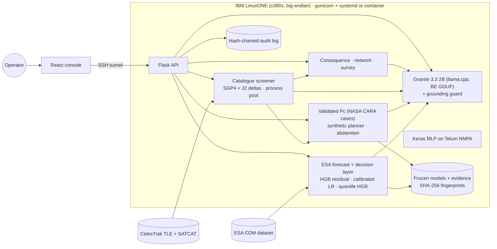

# [Datathon2_IBM Z Datathon 2026 Project]: OrbitGuard, cascade-aware collision avoidance on IBM LinuxONE

> **Avoiding one satellite should not put another in danger.** OrbitGuard tells an operator how likely a close
> approach is, which burn avoids it without creating a new one, and what a collision would cost everyone else in orbit.

**Theme: Real-Time AI for Critical Decisions** (Detect, Decide, Respond). Data and the language model stay on the box,
and every recommendation and operator choice is logged to a tamper-evident chain, so it also covers *AI Secured*.
This is decision support. A human operator makes every call, and the tool never commands a spacecraft.

Event code: `SSF2026`. This repository merges two in-event builds by Team Datathon2, with both git histories
preserved; see [docs/MERGE.md](docs/MERGE.md).

## The problem, with data

- Operators receive a stream of conjunction data messages (CDMs). Most warnings fade and a few are real. In ESA's
  Collision Avoidance Challenge data, only **66 of 8,293** usable training events end at high risk (Pc ≥ 10⁻⁶).
  In the 2019 competition only **12 of 97** teams beat the naive "copy the latest message" baseline.
- Our CelesTrak sweep tracks **18,606** objects. A dodge that clears one object can steer into another. On 50 frozen
  stress scenarios, avoiding only the original object **introduced 20 secondary hazards**.
- A collision probability says nothing about consequence. Two events with similar Pc can endanger very different
  numbers of satellites, and debris from one collision can seed more (the Kessler cascade).

**Who benefits:** satellite operators and flight-dynamics teams, and through them everyone who depends on
navigation, weather, communications and crewed stations in low Earth orbit.

## What it does

| Step | What the operator gets | AI / ML used |
| --- | --- | --- |
| **Detect** (Encounters) | Replays each historical CDM through the server: forecast, alert, **Act / Wait / Monitor**, P(high risk), 80% interval, reasons and measured latency | Gradient-boosted residual (triage ranking), calibrated logistic classifier (P(high)), quantile gradient boosting (interval), cross-validated rule layer, experimental missed-alert guard |
| **Decide** (Manoeuvre planning, Live catalogue) | Screens 37 synthetic or 145 real candidate burns against **every** nearby object with NASA-validated Pc at 0.5x/1x/2x uncertainty. Recommends the cheapest safe burn or **abstains**, and shows what a pair-only check would have done | Physics plus a decision rule (deliberately no ML in the safety gate) |
| **Weigh** (Live catalogue) | Debris from a hypothetical collision, satellites exposed over 30 days, expected harm; Pc rank vs harm rank; catalogue-wide super-spreaders | NASA breakup model, kinetic-gas exposure, graph scoring |
| **Explain** | An operator brief from **IBM Granite 3.3 2B running on LinuxONE**. A grounding guard checks every number against the computed facts and falls back to a template if any number is invented | Generative AI (narrates, never decides) |
| **Account** | Operator accept / defer / reject, plus every forecast, screen and brief, appended to a hash-chained audit log | |
| **Scale** | The same P(high) scorer as a Keras MLP on the **Telum on-chip AI accelerator (NNPA)**: 2.67x faster than CPU at 1M rows | TensorFlow + IBM zDNN plugin |

## Architecture



Data flow for one live decision: SGP4 finds the closest approach in the next 3 days → 145 burns (6 directions ×
6 sizes × 4 lead times) are screened in parallel against every object in the altitude band → each close approach is
refined to its true TCA and scored with the validated Pc → the cheapest burn meeting the miss target with every
worst-case Pc ≤ 10⁻⁴ is recommended (or the tool abstains) → the consequence engine and network give context →
Granite writes the brief → the operator decides and the choice is logged.

## Results

Every number below names the platform it was measured on. **Re-run `bash scripts/run-linuxone-pipeline.sh` on
the VM after deploying this merged version** and quote those outputs: the merge changed the screener and
added the decision-layer evaluation path.

**Measured on LinuxONE s390x** (pre-merge OrbitGuard pipeline, [docs/RESULTS.md](docs/RESULTS.md), [accuracy review](docs/ACCURACY_REVIEW.md)):

| Claim | Evidence |
| --- | --- |
| ESA scoring is correct | Published baseline loss ≈ 0.694; reproduced **0.69396** on 2,167 held-out events |
| ML improves triage *ranking* | Average precision **0.7005 vs 0.6651**; paired-bootstrap 95% CI **[+0.004, +0.064]** |
| We do not claim a better point forecast | Learned residual ESA loss 1.83 vs 0.69; CV chose the baseline before labels were read |
| Pc maths is correct | 3 / 3 NASA CARA reference cases, relative error ≤ 3×10⁻⁶, plus 7 invariance checks |
| All-object screening prevents secondary hazards | 50 scenarios: pair-only **20 hazards introduced**, OrbitGuard **0**; same mean Δv; 10 / 10 correct abstentions |
| Real time on LinuxONE | Forecast p95 **8.5 ms**; 37-candidate screening p95 **1.71 s**; 3 workers **2.77x** faster |

**Measured on the LinuxONE z17 VM** (pre-merge catalogue build, terminal captures in [docs/vm_capture/](docs/vm_capture/)):

| Item | Result |
| --- | --- |
| Platform | s390x, big-endian, machine type 9175 (z17), `nnpa` CPU feature |
| NNPA inference, Keras MLP | 1.06x at 1k rows → **2.67x at 1M rows**; max CPU-vs-NNPA difference 0.0015 |
| Granite 3.3 2B, big-endian q8_0 | Brief generated on the box; grounded |
| Full catalogue pipeline | ISS screening 68 s; survey of 20 events 228 s; 24 h network 101 s |

**Measured on a 12-core Windows development PC** (catalogue build phases and the merged screener):

| Item | Result |
| --- | --- |
| Decision layer (ESA test) | L 0.680 vs naive 0.694; precision 0.673 vs 0.646; 80% interval covers 88% |
| Merged screener, ISS vs ENSHI XIDA SHANQUAN | Miss **3.89 km** after TCA refinement (1 s sampling alone gave 4.98 km); best burn −T 0.2 m/s three orbits ahead → 10.8 km, worst-case Pc 7.5×10⁻¹⁰; 145 burns × 6,754 objects in 12 s |
| Consequence, ISS event | About 11k fragments ≥ 10 cm; 8,943 satellites with ≥ 1 expected pass within 1 km |
| Pc vs harm ranking | Spearman 0.78; 11 of 20 events move 3 or more places |
| Break-up model vs real events | Predicted/catalogued 0.51 (Iridium-Cosmos), 0.35 (Fengyun-1C), 0.77 (Cosmos 1408) |
| Network | 179,075 close approaches in 24 h across the catalogue |

## Why IBM LinuxONE

- **Real-time compute on the box.** The forecast service, the parallel synthetic planner, the catalogue screener
  (process pool with an explicit little-endian `<f8` ephemeris memmap shared between workers) and the network
  sweep all run on the VM's cores.
- **On-chip AI.** The Telum NNPA accelerates the Keras P(high) scorer through TensorFlow and the IBM zDNN plugin, 2.67x at scale.
- **On-box GenAI and data residency.** Granite runs locally via llama.cpp on a big-endian GGUF converted for s390x
  ([porting](docs/porting.md)). No external AI API is called; only public TLE and SATCAT downloads come in.
- **Porting done properly.** The sgp4 C extension is built from source (the s390x pure-Python fallback was about 70x
  slower). The code uses explicit byte order, spawn-safe multiprocessing, and models retrained on the VM rather than copied.
- **Security and integrity.** A hardened systemd unit (NoNewPrivileges, ProtectSystem=strict, writes only to
  `artifacts/`) binds to loopback behind an SSH tunnel. Model fingerprints are SHA-256. The audit log is a hash
  chain. Secure Execution and pervasive encryption are a design note, not something we ran.
- **Containerised.** A multi-stage [Dockerfile](Dockerfile) builds the console and runs gunicorn on the official s390x image.

## Run it

### Laptop (development)

```bash
python -m venv .venv && .venv/bin/pip install -e '.[dev]'        # Windows: .venv\Scripts\pip
(cd frontend && npm ci && npm run build)
python scripts/demo.py --quick         # ESA data, models, physics checks, live ISS analysis, then serves :8080
python -m pytest -q
```

### LinuxONE VM

```bash
python3 scripts/linuxone.py sync --host <VM_IP> --key key.pem        # from the laptop: source + built console
bash scripts/bootstrap-linuxone.sh                                   # on the VM: native stack, sgp4 C extension
.venv/bin/orbitguard fetch-data && .venv/bin/orbitguard prepare-data
bash scripts/run-linuxone-pipeline.sh                                # every evidence step, stops on first failure
sudo cp deploy/orbitguard.service /etc/systemd/system/ && sudo systemctl enable --now orbitguard
bash scripts/evidence.sh                                             # lscpu, NNPA flag, containers, audit verify
python3 scripts/linuxone.py tunnel --host <VM_IP> --key key.pem      # laptop: open http://localhost:8080
```

Granite on the VM: [docs/porting.md](docs/porting.md) and `scripts/convert_granite_bigendian.sh`, then set
`LLM_BACKEND=llamacpp` and `LLM_MODEL_PATH`. NNPA benchmark: `orbitguard nnpa-bench` inside the Jupyter ML image.
Full runbook: [docs/vm_runbook.md](docs/vm_runbook.md).

### Docker

```bash
docker build -t orbitguard .                     # x86: --build-arg BASE=python:3.12-slim
docker run -d -p 8080:8080 -v $PWD/artifacts:/app/artifacts orbitguard
```

### Commands

`orbitguard <command>`: `fetch-data`, `prepare-data`, `train`, `evaluate`, `audit-accuracy`, `train-triage`,
`evaluate-triage`, `train-guard`, `evaluate-guard`, `decision-fit`, `decision-eval`, `validate-physics`,
`benchmark-planner`, `benchmark-runtime`, `screen-live`, `consequence`, `validate-breakup`, `network`, `brief`,
`nnpa-bench`, `nnpa-report`, `audit-verify`, `environment`, `serve`.

## Evaluation integrity

- Official ESA split only; train and test IDs are namespaced, and we checked for zero duplicate CDMs across splits.
- Every forecast feature comes from messages at least 48 hours before TCA. The API rejects later messages and any label-like field.
- Test labels stay inside a sealed ZIP member. They are opened only after the artefact under evaluation is frozen,
  and its SHA-256 is recorded before and after (for both the forecast model and the decision layer).
- Rules, thresholds and calibrations are chosen on training-set cross-validation. The public test set has been
  reused across project versions, so later checks are retrospective, not blind.
- Undefined scores, abstentions and numerical failures are reported, never dropped. Missing artefacts show as missing in the UI.

## Limitations

- The ESA target is a *later reported risk estimate*, not an observed collision, and ESA's splits over-represent high-risk events.
- Public TLEs carry about 1 km of error and no covariance. Catalogue Pc uses an assumed RTN error (0.5 / 1 / 0.5 km),
  so it is a screening indicator. Burns use a J2 delta model on top of SGP4 and ignore drag.
- The synthetic planner uses two-body gravity, impulsive tangential burns and prescribed covariance. The 50-scenario
  mix is a stress test, not real-world prevalence.
- Masses are assumed by object type. The break-up model under-predicts fragment counts (ratios 0.35 to 0.77), so
  consequence and super-spreader scores are for ranking.
- The decision layer's gain over the baseline is small and its 80% interval is wide. Granite sometimes phrases
  uncertainty loosely; the guard checks numbers, not wording.

## Repository map

```
orbitguard/ml/           ESA data (sealed labels), residual model, triage, guard, accuracy audit, forecast service
orbitguard/decision/     Act / Wait / Monitor: features, CV rules, calibrated P(high), quantile interval, replay
orbitguard/physics/      validated Pc, two-body propagation, synthetic planner and scenarios, NASA cases
orbitguard/catalog/      CelesTrak catalogue, SGP4 + J2 burn deltas, parallel screener, Pc bridge (collision.py)
orbitguard/consequence/  breakup, debris cloud, exposure, expected harm, survey, break-up validation
orbitguard/network/      catalogue-wide close-approach graph and super-spreader score
orbitguard/brief/        facts, Granite / OpenAI-compatible / template backends, grounding guard
orbitguard/audit/        hash-chained decision log
orbitguard/nnpa/         Telum NNPA benchmark (TensorFlow + ibm-zdnn-plugin)
orbitguard/api.py, live.py   Flask API: forecasts, replay, planning jobs, live catalogue, brief, audit, platform
frontend/                React console (Encounters, Manoeuvre planning, Live catalogue, Validation, How it works)
scripts/ deploy/ Dockerfile   LinuxONE bootstrap, evidence pipeline, sync/tunnel, systemd, container
docs/                    MERGE.md, RESULTS.md, ACCURACY_REVIEW.md, phases/, porting.md, vm_runbook.md, validation notes
```

## Credits and open-source resources

Data and references:
- ESA Collision Avoidance Challenge dataset (CC BY 4.0, © ESA): https://zenodo.org/records/4463683 · https://kelvins.esa.int/collision-avoidance-challenge/
- Uriot et al., "Spacecraft collision avoidance challenge": https://arxiv.org/abs/2008.03069
- NASA CARA Analysis Tools reference cases (our Pc implementation is independent): https://github.com/nasa/CARA_Analysis_Tools · Alfano (2009) test cases
- CelesTrak TLE catalogue and SATCAT: https://celestrak.org
- Vallado, Crawford, Hujsak, Kelso, "Revisiting Spacetrack Report #3": https://celestrak.org/publications/AIAA/2006-6753/
- Johnson et al., "NASA's new breakup model of EVOLVE 4.0" (2001): https://doi.org/10.1016/S0273-1177(01)00423-9
- Along-track manoeuvre optimality (Bombardelli group): https://oa.upm.es/51461/
- IBM Granite 3.3 2B Instruct: https://huggingface.co/ibm-granite/granite-3.3-2b-instruct · GGUF: https://huggingface.co/ibm-granite/granite-3.3-2b-instruct-GGUF

Python: NumPy https://numpy.org · pandas https://pandas.pydata.org · SciPy https://scipy.org ·
scikit-learn https://scikit-learn.org · joblib https://joblib.readthedocs.io · threadpoolctl https://github.com/joblib/threadpoolctl ·
sgp4 https://pypi.org/project/sgp4/ · Flask https://flask.palletsprojects.com · gunicorn https://gunicorn.org ·
pytest https://pytest.org · llama.cpp https://github.com/ggml-org/llama.cpp (s390x notes: https://github.com/ggml-org/llama.cpp/blob/master/docs/build-s390x.md) ·
llama-cpp-python https://github.com/abetlen/llama-cpp-python · TensorFlow https://www.tensorflow.org ·
IBM zDNN plugin for TensorFlow https://pypi.org/project/ibm-zdnn-plugin/

Console: React https://react.dev · TypeScript https://www.typescriptlang.org · Vite https://vite.dev ·
Recharts https://recharts.org · three.js https://threejs.org · d3-geo https://github.com/d3/d3-geo ·
topojson-client https://github.com/topojson/topojson-client · world-atlas (Natural Earth) https://github.com/topojson/world-atlas ·
Lucide https://lucide.dev · IBM Plex via Fontsource https://fontsource.org · Playwright (smoke tests) https://playwright.dev
