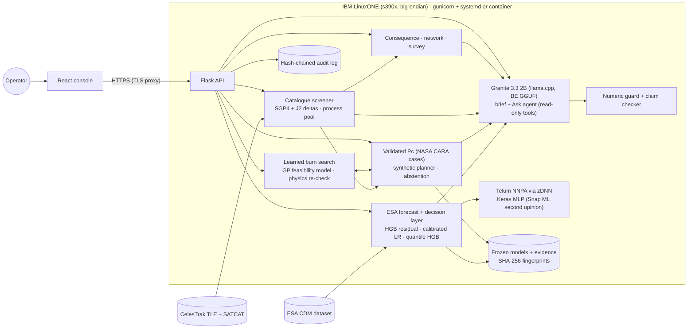
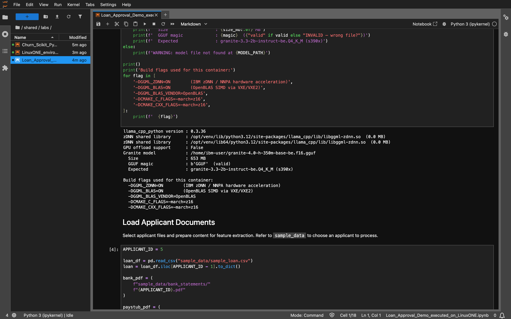

# Datathon2 OrbitGuard - IBM Z Datathon 2026 Project: OrbitGuard, cascade-aware collision avoidance on IBM LinuxONE

> **Avoiding one satellite should not put another in danger.** OrbitGuard tells an operator how likely a close
> approach is, which burn avoids it without creating a new one, and what a collision would cost everyone else in orbit.

**Theme: Real-Time AI for Critical Decisions** (Detect, Decide, Respond) · **Runs on IBM LinuxONE (s390x, big-endian)**

- Live console: https://148.100.76.224
- Demo video: https://drive.google.com/file/d/1p-Yoz6Kvqe6NaHZcIzj3-w24xxdOIE5I/view?usp=sharing
- Team: Aryash Mullick, Raj Yash, Suraj Balaji Bangarusamy, Bhavya Puri, Dhruv Gupta

Data and the language model stay on the box, and every recommendation and operator choice is logged to a
tamper-evident chain, so it also covers *AI Secured*. This is decision support. A human operator makes every call,
and the tool never commands a spacecraft.

## Contents

1. [The problem, with data](#the-problem-with-data)
2. [What it does](#what-it-does)
3. [Live demo](#live-demo)
4. [How it uses IBM LinuxONE](#how-it-uses-ibm-linuxone)
5. [Results](#results)
6. [Architecture](#architecture)
7. [Supporting documents](#supporting-documents)
8. [Where AI is used, and where it deliberately is not](#where-ai-is-used-and-where-it-deliberately-is-not)
9. [Prerequisite labs (completed on LinuxONE)](#prerequisite-labs-completed-on-linuxone)
10. [Run it](#run-it)
11. [Evaluation integrity](#evaluation-integrity)
12. [Limitations](#limitations)
13. [Porting notes](#porting-notes)
14. [Repository map](#repository-map)
15. [Further documentation](#further-documentation)
16. [Credits and open-source resources](#credits-and-open-source-resources)

## The problem, with data

- Operators receive a stream of conjunction data messages (CDMs). Most warnings fade and a few are real. In ESA's
  Collision Avoidance Challenge data, only **66 of 8,293** usable training events end at high risk (Pc ≥ 10⁻⁶).
  In the 2019 competition only **12 of 97** teams beat the naive "copy the latest message" baseline.
- Our CelesTrak sweep tracks **18,606** objects. A dodge that clears one object can steer into another. On 50 frozen
  stress scenarios, avoiding only the original object **introduced 20 secondary hazards**.
- A collision probability says nothing about consequence. Two events with similar Pc can endanger very different
  numbers of satellites, and debris from one collision can seed more (the Kessler cascade).

**Who benefits:** satellite operators and flight-dynamics teams, and through them everyone who depends on
navigation, weather, communications and crewed stations in low Earth orbit.

## What it does

| Step | What the operator gets | AI / ML used |
| --- | --- | --- |
| **Detect** (Encounters) | Replays each historical CDM through the server: forecast, alert, **Act / Wait / Monitor**, P(high risk), 80% interval, reasons and measured latency. A second model gives an independent P(high) and flags the event for review when the two disagree | Gradient-boosted residual (triage ranking), calibrated logistic classifier (P(high)), quantile gradient boosting (interval), cross-validated rule layer, **IBM Snap ML** boosted trees scored on the Telum accelerator through zDNN (second opinion) |
| **Decide** (Manoeuvre planning, Live catalogue) | Screens 37 synthetic or 145 real candidate burns against **every** nearby object with NASA-validated Pc at 0.5x/1x/2x uncertainty. Recommends the cheapest safe burn or **abstains**, and shows what a pair-only check would have done. A learned search then looks *between* the grid points for a cheaper burn that passes the same rule | Physics decides what is safe. **Constrained Bayesian optimisation** (a Gaussian-process model of the safety margin) proposes burns, and every proposal is re-checked by the full physics rule before it can be recommended |
| **Weigh** (Live catalogue) | Debris from a hypothetical collision, satellites exposed over 30 days, expected harm; Pc rank vs harm rank; catalogue-wide super-spreaders | NASA breakup model, kinetic-gas exposure, graph scoring |
| **Explain** | An operator brief from **IBM Granite 3.3 2B running on LinuxONE**. Two checks run before the operator sees it: a numeric guard (every number must match a computed fact) and a claim checker (direction, action, object names, whether the pair-only burn is safe, no "guaranteed safe"). Either one failing swaps in a template brief | Generative AI that narrates and never decides. We also tested IBM Granite Guardian as a third check; it missed every subtle error, so it ships switched off (see below) |
| **Ask** (Live catalogue) | The operator types a question such as "what if I burn one orbit later?" Granite picks from read-only tools (look up a screened burn, compare with the pair-only policy, debris consequence, audit trail), and the answer goes through both guards | Agentic Granite with JSON-grammar tool calls. The tools only read results the physics already computed |
| **Account** | Operator accept / defer / reject, plus every forecast, screen, brief and question, appended to a hash-chained audit log (SHA-256, which OpenSSL runs on the CPACF crypto instructions on IBM Z) | |
| **Scale** | The P(high) scorers on the **Telum on-chip AI accelerator (NNPA)**: a Keras MLP through the IBM zDNN TensorFlow plugin (**3.4x** faster than CPU at 1M rows on the z17 VM). Snap ML's zDNN tree path was tested too: identical predictions, but slower than its CPU path on this VM, so the live second opinion uses CPU | TensorFlow + IBM zDNN plugin, IBM Snap ML |

## Live demo

The React console is served from the LinuxONE VM at https://148.100.76.224. Its tabs are Encounters, Manoeuvre planning,
Live catalogue (with Ask), Validation and How it works. The Validation tab reads the evidence artefacts and shows
"missing" where a number cannot be backed. Terminal captures from the VM are in [docs/vm_capture/](docs/vm_capture/), and
screenshots are in [docs/evidence/](docs/evidence/README.md) and [docs/labs/](docs/labs/README.md). The demo video is linked at the top of this file.

## How it uses IBM LinuxONE

- **Real-time compute on the box.** The forecast service, the parallel synthetic planner, the catalogue screener
  (process pool with an explicit little-endian `<f8` ephemeris memmap shared between workers) and the network
  sweep all run on the VM's cores.
- **On-chip AI.** The Telum NNPA accelerates the Keras P(high) scorer through TensorFlow and the IBM zDNN plugin: 3.43x at
  1M rows on the z17 VM, with TensorFlow's log showing the fused zDNN MatMul kernels in use. We also ran **IBM Snap ML**'s
  boosted trees through zDNN (`tree_format="zdnn_tensors"`, the same PMML trees as the CPU path). Predictions were
  identical but slower than Snap ML's compressed CPU trees here, so the second opinion picks the faster measured path
  (`orbitguard zai-bench` writes the table, and the scorer reads it).
- **IBM's own models, on the box.** Granite 3.3 2B writes the brief and drives the Ask agent in llama.cpp on a big-endian
  GGUF converted for s390x (see [Porting notes](#porting-notes)). No external AI API is called; only public TLE and SATCAT
  downloads come in. Granite Guardian converts and runs the same way, and we measured it rather than assumed it helps.
- **Porting done properly.** The sgp4 C extension is built from source (the s390x pure-Python fallback was about 70x
  slower). The code uses explicit byte order, spawn-safe multiprocessing, and models retrained on the VM rather than copied.
- **Security and integrity.** A hardened systemd unit (NoNewPrivileges, ProtectSystem=strict, writes only to
  `artifacts/`) binds to loopback; the public demo at https://148.100.76.224 goes through a TLS proxy with a Let's Encrypt
  IP certificate ([scripts/linuxone-public.sh](scripts/linuxone-public.sh)). Model fingerprints are SHA-256. The audit log is a hash
  chain. Python's `hashlib` goes through OpenSSL, which uses the CPACF crypto instructions on IBM Z for SHA-256;
  `scripts/evidence.sh` records the message-security-assist flags and throughput. Secure Execution and pervasive
  encryption are a design note, not something we ran.
- **Containerised.** A multi-stage [Dockerfile](Dockerfile) builds the console and runs gunicorn on the official s390x image.

## Results

Every number below names the platform and build it was measured on. The code base combines two builds made during the
event; tables marked "pre-merge" were measured on one of those
builds before they were combined. `bash scripts/run-linuxone-pipeline.sh` regenerates the combined-build numbers.

**Measured on the LinuxONE z17 VM, merged build, 2026-10-17** (`scripts/run-linuxone-pipeline.sh`, all 23 steps OK in 36 min on 3 vCPUs):

| Item | Result |
| --- | --- |
| Real time | Forecast with decision layer p50 **45 ms**, p95 **49 ms**; 37-candidate synthetic screen p95 **1.83 s**; 3 workers **2.76x** faster than 1 |
| Live ISS screen (real CelesTrak catalogue) | **144 burns × 6,753 objects**: burn screen 46 s, end to end 77 s including SGP4 for the whole catalogue. ISS vs ENSHI XIDA SHANQUAN, miss 3.74 km, best burn −T 0.2 m/s three orbits ahead |
| NNPA, Keras MLP (TensorFlow + IBM zDNN plugin 2.3.0) | 1.44x at 1k rows → **3.43x at 1M rows** (888k vs 259k rows/s); max CPU-vs-NNPA difference 0.0015 |
| Snap ML 1.17.2 trees, zDNN vs CPU | Predictions identical (max difference 0.0); zDNN path 0.05x to 0.49x the speed of Snap ML's compressed CPU trees, which reach 8 to 14M rows/s. So the live service uses CPU for this model |
| Forecasting, workload, learned burn search, Snap ML accuracy | Same values as the table above (seeded, deterministic) |
| Granite 3.3 2B q8_0, big-endian | Brief for the ISS event generated on the box (several minutes on 3 vCPUs; cached afterwards) |

**Measured on LinuxONE s390x** (pre-merge OrbitGuard pipeline, [docs/RESULTS.md](docs/RESULTS.md), [accuracy review](docs/ACCURACY_REVIEW.md)):

| Claim | Evidence |
| --- | --- |
| ESA scoring is correct | Published baseline loss ≈ 0.694; reproduced **0.69396** on 2,167 held-out events |
| ML improves triage *ranking* | Average precision **0.7005 vs 0.6651**; paired-bootstrap 95% CI **[+0.004, +0.064]** |
| We do not claim a better point forecast | Learned residual ESA loss 1.83 vs 0.69; CV chose the baseline before labels were read |
| Pc maths is correct | 3 / 3 NASA CARA reference cases, relative error ≤ 3×10⁻⁶, plus 7 invariance checks |
| All-object screening prevents secondary hazards | 50 scenarios: pair-only **20 hazards introduced**, OrbitGuard **0**; same mean Δv; 10 / 10 correct abstentions |
| Real time on LinuxONE | Forecast p95 **8.5 ms**; 37-candidate screening p95 **1.71 s**; 3 workers **2.77x** faster |

**Measured on the LinuxONE z17 VM** (pre-merge catalogue build, terminal captures in [docs/vm_capture/](docs/vm_capture/)):

| Item | Result |
| --- | --- |
| Platform | s390x, big-endian, machine type 9175 (z17), `nnpa` CPU feature |
| NNPA inference, Keras MLP | 1.06x at 1k rows → **2.67x at 1M rows**; max CPU-vs-NNPA difference 0.0015 |
| Granite 3.3 2B, big-endian q8_0 | Brief generated on the box; grounded |
| Full catalogue pipeline | ISS screening 68 s; survey of 20 events 228 s; 24 h network 101 s |

**Measured on a 12-core Windows development PC** (catalogue build phases and the merged screener):

| Item | Result |
| --- | --- |
| Decision layer (ESA test) | L 0.680 vs naive 0.694, but ΔL 95% CI [−0.071, +0.040], so **not significant**; precision 0.673 vs 0.646; 80% interval covers 88% |
| Snap ML second opinion | AP 0.705 vs naive 0.665, CI [−0.011, +0.088]; vs decision-layer P(high) +0.092, CI [+0.041, +0.143] |
| Alert workload, equal budget (178 alerts) | Naive 115 caught; triage 110 (CI of difference [−14, +4]); decision P(high) 103 ([−22, −2]) |
| Learned burn search, 50 scenarios, 37 evaluations | Median Δv 0.875x the grid, CI [0.826, 0.889], 30 wins / 10 ties / 0 losses; uniform random 1.72x; finer grid 0.93x; abstentions identical |
| Learned burn search, ISS live event | 0.18 m/s (warm-started) vs grid 0.20 m/s, same all-object rule; one event, so no statistics |
| Merged screener, ISS vs ENSHI XIDA SHANQUAN | Miss **3.89 km** after TCA refinement (1 s sampling alone gave 4.98 km); best burn −T 0.2 m/s three orbits ahead → 10.8 km, worst-case Pc 7.5×10⁻¹⁰; 145 burns × 6,754 objects in 12 s |
| Consequence, ISS event | About 11k fragments ≥ 10 cm; 8,943 satellites with ≥ 1 expected pass within 1 km |
| Pc vs harm ranking | Spearman 0.78; 11 of 20 events move 3 or more places |
| Break-up model vs real events | Predicted/catalogued 0.51 (Iridium-Cosmos), 0.35 (Fengyun-1C), 0.77 (Cosmos 1408) |
| Network | 179,075 close approaches in 24 h across the catalogue |

## Architecture

Operator flow: see the [solution flowchart](docs/SOLUTION_OVERVIEW.md#solution-flowchart).

Rendered diagram and notes: [docs/architecture-catalog.md](docs/architecture-catalog.md), [docs/architecture-catalog.svg](docs/architecture-catalog.svg).



Data flow for one live decision: SGP4 finds the closest approach in the next 3 days → 145 burns (6 directions ×
6 sizes × 4 lead times) are screened in parallel against every object in the altitude band → each close approach is
refined to its true TCA and scored with the validated Pc → the cheapest burn meeting the miss target with every
worst-case Pc ≤ 10⁻⁴ is recommended (or the tool abstains) → the consequence engine and network give context →
Granite writes the brief, the numeric guard and claim checker check it → the operator can ask follow-up questions, then
decides, and the choice is logged.

## Supporting documents

- [Solution flowchart](docs/SOLUTION_OVERVIEW.md#solution-flowchart) ([SVG](docs/diagrams/solution-flowchart.svg)): the operator flow from warning to audited decision.
- [System architecture diagram](docs/SOLUTION_OVERVIEW.md#system-architecture) ([SVG](docs/diagrams/system-architecture.svg)): browser, HTTPS, container on LinuxONE, modules, data sources.
- [Full overview with pipeline and deployment](docs/SOLUTION_OVERVIEW.md), and the technical documents it links (results, accuracy review, judging guide, VM runbook).

## Where AI is used, and where it deliberately is not

We tested every AI component against a simple, non-AI alternative on the same data, and we report the losses
along with the wins. Every number in this table was re-measured on the LinuxONE z17 VM on 2026-10-17 by
`scripts/run-linuxone-pipeline.sh` (the seeded runs gave the same values as the development PC). The console's
Validation tab reads the same artefacts and labels them with their host.

| Question | Answer | Evidence |
| --- | --- | --- |
| Can ML forecast the final ESA risk better than "copy the latest message"? | **No, not significantly.** The decision layer's ESA loss is 0.680 vs 0.694, but the paired-bootstrap 95% CI of the difference is [−0.071, +0.040]. We keep the baseline as the default forecast | `decision-eval` → `artifacts/ml/decision_evidence.json` |
| Can ML rank dangerous encounters better? | **Yes, a little.** Triage average precision 0.7005 vs 0.6651, CI [+0.004, +0.064]. Snap ML 0.705, CI vs naive [−0.011, +0.088], not significant on its own | `evaluate-triage`, `zai-eval` |
| Does that save an operator work? | **Not at an equal alert budget.** At the naive rule's 178 alerts, triage catches 110 high-risk events vs 115 (difference CI [−14, +4]). Run in safety-first mode, ML catches a few more events, costing about 9 extra reviews per extra catch | `workload-eval` → `artifacts/ml/workload_evidence.json` |
| Can learning find cheaper safe burns? | **Yes.** On the 50 frozen scenarios, Bayesian optimisation needs a median **12.5% less Δv** than the grid (ratio 0.875, CI [0.826, 0.889]). It wins 30, ties 10 and loses 0, and every pick is physics-verified. Random search with the same 37 physics evaluations does worse than the grid (1.72x Δv). Abstentions match the grid, and no impossible scenario was "solved" | `optimise-burns` → `artifacts/optimise/evidence.json` |
| Do the guards catch a wrong brief? | **Mostly.** Numeric guard: 78% of changed numbers (n=40). Claim checker: 100% of our synthetic non-numeric errors (n=40), but only **80% of errors Granite itself wrote** (n=10, a set the checker wasn't built against). Zero false alarms on 40 good, 10 held-out and 5 real Granite briefs. Granite Guardian (Q8_0) caught **0 of 40**, because a one-line error gets lost in a 2,000-character brief, so we left it off by default (`GUARDIAN_MODE=off`) | `guard-eval` → `artifacts/llm/guard_eval.json` |

So the ML is not the oracle. The AI does three useful jobs: it ranks the queue a little better, it finds cheaper
burns that the physics can then prove safe, and it explains and answers questions under two independent checks.
None of it can override the physics or the operator. The decision path itself (Pc, burn acceptance, abstention) contains
no language model: Granite narrates computed facts, and the grounding guard rejects invented numbers.

## Prerequisite labs (completed on LinuxONE)

Both guidebook labs from [linuxone-community-cloud/jupyter-lab-ml](https://github.com/linuxone-community-cloud/jupyter-lab-ml)
ran end to end on the team VM (s390x, machine type 9175) inside IBM's Jupyter Lab container on 17 Oct 2026. The executed
notebooks, with their outputs, and screenshots are in [docs/labs/](docs/labs/README.md).

| Lab | Notebook | Result on LinuxONE |
| --- | --- | --- |
| 1. Predictive AI, hybrid multi-model | [Churn (scikit-learn + PyTorch)](docs/labs/Churn_Scikit_PyTorch_executed_on_LinuxONE.ipynb) | 31 of 31 code cells, 0 errors. Random Forest exported to PMML; PyTorch test accuracy 76.2% |
| 2. Predictive AI + Generative AI | [Loan approval (Granite + XGBoost)](docs/labs/Loan_Approval_Demo_executed_on_LinuxONE.ipynb) | 9 of 9 code cells, 0 errors. Granite on llama.cpp built with zDNN/NNPA extracts features, XGBoost scores risk: applicant 5 low risk (p = 0.997), "Approve" |
| Environment check | [LinuxONE_environment_check.ipynb](docs/labs/LinuxONE_environment_check.ipynb) | `s390x`, `IBM/S390`, machine 9175 from inside the same container |



## Run it

### Laptop (development)

```bash
python -m venv .venv && .venv/bin/pip install -e '.[dev]'        # Windows: .venv\Scripts\pip
(cd frontend && npm ci && npm run build)
python scripts/demo.py --quick         # ESA data, models, physics checks, live ISS analysis, then serves :8080
python -m pytest -q
```

### LinuxONE VM

```bash
python3 scripts/linuxone.py sync --host <VM_IP> --key key.pem        # from the laptop: source + built console
bash scripts/bootstrap-linuxone.sh                                   # on the VM: native stack, sgp4 C extension
.venv/bin/orbitguard fetch-data && .venv/bin/orbitguard prepare-data
bash scripts/run-linuxone-pipeline.sh                                # every evidence step, stops on first failure
sudo cp deploy/orbitguard.service /etc/systemd/system/ && sudo systemctl enable --now orbitguard
bash scripts/evidence.sh                                             # lscpu, NNPA flag, containers, audit verify
python3 scripts/linuxone.py tunnel --host <VM_IP> --key key.pem      # laptop: open http://localhost:8080
```

Granite on the VM: [Porting notes](#porting-notes) and `scripts/convert_granite_bigendian.sh`, then set
`LLM_BACKEND=llamacpp` and `LLM_MODEL_PATH`. NNPA benchmark: `orbitguard nnpa-bench` inside the Jupyter ML image.
Full runbook: [docs/vm_runbook.md](docs/vm_runbook.md).

### Docker

```bash
docker build -t orbitguard .                     # x86: --build-arg BASE=python:3.12-slim
docker run -d -p 8080:8080 -v $PWD/artifacts:/app/artifacts orbitguard
```

## Evaluation integrity

- Official ESA split only; train and test IDs are namespaced, and we checked for zero duplicate CDMs across splits.
- Every forecast feature comes from messages at least 48 hours before TCA. The API rejects later messages and any label-like field.
- Who can read what is enforced by tests, not just convention: see [docs/DATA_BOUNDARIES.md](docs/DATA_BOUNDARIES.md) and `tests/test_boundaries.py`.
- Test labels stay inside a sealed ZIP member. They are opened only after the artefact under evaluation is frozen,
  and its SHA-256 is recorded before and after (for both the forecast model and the decision layer).
- Rules, thresholds and calibrations are chosen on training-set cross-validation. The public test set has been
  reused across project versions, so later checks are retrospective, not blind.
- Undefined scores, abstentions and numerical failures are reported, never dropped. Missing artefacts show as missing in the UI.

## Limitations

- The ESA target is a *later reported risk estimate*, not an observed collision, and ESA's splits over-represent high-risk events.
- Public TLEs carry about 1 km of error and no covariance. Catalogue Pc uses an assumed RTN error (0.5 / 1 / 0.5 km),
  so it is a screening indicator. Burns use a J2 delta model on top of SGP4 and ignore drag.
- The synthetic planner uses two-body gravity, impulsive tangential burns and prescribed covariance. The 50-scenario
  mix is a stress test, not real-world prevalence.
- Masses are assumed by object type. The break-up model under-predicts fragment counts (ratios 0.35 to 0.77), so
  consequence and super-spreader scores are for ranking.
- The decision layer's gain over the baseline is not statistically significant, and its 80% interval is wide. At an
  equal alert budget no ML ranker beats the naive rule.
- The learned burn search covers along-track burns in the grid's time window. Its gain is measured on the synthetic
  suite; on the live catalogue we have a single event.
- Granite 2B sometimes picks the wrong tool arguments in Ask, and then the guard falls back to a template answer.
  The claim checker only knows the claim types we listed, and it caught 8 of the 10 errors Granite wrote, so it is
  a safety net, not a proof. Granite Guardian missed every subtle error at Q8_0 and flagged everything at Q4_K_M.

## Porting notes

- Granite must be a big-endian GGUF on s390x. Convert the Hugging Face safetensors on the VM with llama.cpp's
  `convert_hf_to_gguf.py --bigendian` (`scripts/convert_granite_bigendian.sh` does this; Q4_0, Q4_K, Q5_K, Q6_K and Q8_0 have s390x
  SIMD paths). See the [s390x build notes](https://github.com/ggml-org/llama.cpp/blob/master/docs/build-s390x.md) and [docs/vm_runbook.md](docs/vm_runbook.md).
- The sgp4 package has no s390x wheel, so pip silently installs a pure-Python fallback (`sgp4.api.accelerated == False`)
  that made the screener about 70x slower (939 s). The Dockerfile and bootstrap build the C extension with `--no-binary=sgp4` and check it.
- The Telum accelerator is switched by the `NNPA_DEVICES` environment variable (`0` disables the zDNN rewrite, unset or `1` enables it;
  set it before importing TensorFlow). `tf.config.list_physical_devices()` shows only CPU because the plugin rewrites graph ops
  instead of registering a device. The evidence is the fused zDNN MatMul kernels in TensorFlow's log and a prediction difference of up to 1.5e-3 (DLFLOAT16).
- Rules we followed: no pickles or model files copied between machines (retrain on the VM, move data as CSV or JSON), explicit byte
  order for raw bytes (`<f8`), spawn-safe multiprocessing, `pathlib` only, UTF-8 and LF line endings.

## Repository map

```
orbitguard/ml/           ESA data (sealed labels), residual model, triage, guard, accuracy audit, forecast service
orbitguard/decision/     Act / Wait / Monitor: features, CV rules, calibrated P(high), quantile interval, replay
orbitguard/physics/      validated Pc, two-body propagation, synthetic planner and scenarios, NASA cases
orbitguard/catalog/      CelesTrak catalogue, SGP4 + J2 burn deltas, parallel screener, Pc bridge (collision.py)
orbitguard/consequence/  breakup, debris cloud, exposure, expected harm, survey, break-up validation
orbitguard/network/      catalogue-wide close-approach graph and super-spreader score
orbitguard/brief/        facts, Granite / OpenAI-compatible / template backends, numeric guard, claim checker, Granite Guardian (off by default), Ask agent, guard eval
orbitguard/audit/        hash-chained decision log
orbitguard/nnpa/         Telum NNPA benchmark (TensorFlow + ibm-zdnn-plugin)
orbitguard/zai/          IBM Snap ML second-opinion scorer, zDNN tree inference, CPU-vs-NNPA bench
orbitguard/optimise/     constrained Bayesian-optimisation burn search, verified by the physics rule
orbitguard/api.py, live.py   Flask API: forecasts, replay, planning jobs, live catalogue, brief, audit, platform
frontend/                React console (Encounters, Manoeuvre planning, Live catalogue + Ask, Validation + AI evidence, How it works)
scripts/ deploy/ Dockerfile   LinuxONE bootstrap, evidence pipeline, sync/tunnel, systemd, container
tests/                   pytest suite, including the enforced data-boundary tests
docs/                    results, reviews, runbook, phase notes, evidence, labs, VM captures
video/                   scripts that build the demo video
```

## Further documentation

| Document | What it holds |
| --- | --- |
| [docs/JUDGING_GUIDE.md](docs/JUDGING_GUIDE.md) | Each judging criterion with the command or file that proves it |
| [docs/RESULTS.md](docs/RESULTS.md) | Original LinuxONE deployment report (pre-merge pipeline) |
| [docs/ACCURACY_REVIEW.md](docs/ACCURACY_REVIEW.md) | Review of the ESA scoring reproduction and forecast fixes, with fingerprints |
| [docs/RECALL_IMPROVEMENT.md](docs/RECALL_IMPROVEMENT.md) | Work on improving high-risk recall |
| [docs/DATA_BOUNDARIES.md](docs/DATA_BOUNDARIES.md) | Which code may read labels and which modules may import which, enforced by tests |
| [docs/EVENT_REPLAY.md](docs/EVENT_REPLAY.md) | How historical events are replayed through the service |
| [docs/breakup-validation.md](docs/breakup-validation.md) | Break-up model against real fragmentation events |
| [docs/architecture-catalog.md](docs/architecture-catalog.md) | Architecture of the catalogue and consequence path ([SVG](docs/architecture-catalog.svg)) |
| [docs/phases/README.md](docs/phases/README.md) | Per-phase build notes |
| [docs/vm_runbook.md](docs/vm_runbook.md) | LinuxONE VM runbook, including what worked on the VM |
| [docs/vm_capture/](docs/vm_capture/) | Terminal captures from the VM (platform, NNPA, Granite, CPACF) |
| [docs/evidence/README.md](docs/evidence/README.md) | Review artefacts (accuracy, guard, physics, triage, runtime) |
| [docs/labs/README.md](docs/labs/README.md) | Executed prerequisite-lab notebooks and screenshots |
| [frontend/README.md](frontend/README.md) | Console build and structure |
| [orbitguard/audit/README.md](orbitguard/audit/README.md) | Hash-chained audit log |
| [video/README.md](video/README.md) | Demo video build |

## Credits and open-source resources

Data and references:
- ESA Collision Avoidance Challenge dataset (CC BY 4.0, © ESA): https://zenodo.org/records/4463683 · https://kelvins.esa.int/collision-avoidance-challenge/
- Uriot et al., "Spacecraft collision avoidance challenge": https://arxiv.org/abs/2008.03069
- NASA CARA Analysis Tools reference cases (our Pc implementation is independent): https://github.com/nasa/CARA_Analysis_Tools · Alfano (2009) test cases
- CelesTrak TLE catalogue and SATCAT: https://celestrak.org
- Vallado, Crawford, Hujsak, Kelso, "Revisiting Spacetrack Report #3": https://celestrak.org/publications/AIAA/2006-6753/
- Johnson et al., "NASA's new breakup model of EVOLVE 4.0" (2001): https://doi.org/10.1016/S0273-1177(01)00423-9
- Along-track manoeuvre optimality (Bombardelli group): https://oa.upm.es/51461/
- IBM Granite 3.3 2B Instruct: https://huggingface.co/ibm-granite/granite-3.3-2b-instruct · GGUF: https://huggingface.co/ibm-granite/granite-3.3-2b-instruct-GGUF
- IBM Granite Guardian 3.2 3B-A800M (groundedness check, evaluated; off by default): https://huggingface.co/ibm-granite/granite-guardian-3.2-3b-a800m

Python: NumPy https://numpy.org · pandas https://pandas.pydata.org · SciPy https://scipy.org ·
scikit-learn https://scikit-learn.org · joblib https://joblib.readthedocs.io · threadpoolctl https://github.com/joblib/threadpoolctl ·
sgp4 https://pypi.org/project/sgp4/ · Flask https://flask.palletsprojects.com · gunicorn https://gunicorn.org ·
pytest https://pytest.org · llama.cpp https://github.com/ggml-org/llama.cpp (s390x notes: https://github.com/ggml-org/llama.cpp/blob/master/docs/build-s390x.md) ·
llama-cpp-python https://github.com/abetlen/llama-cpp-python · TensorFlow https://www.tensorflow.org ·
IBM zDNN plugin for TensorFlow https://pypi.org/project/ibm-zdnn-plugin/ ·
IBM Snap ML https://snapml.readthedocs.io · https://pypi.org/project/snapml/

Prerequisite labs: IBM LinuxONE Community Cloud Jupyter Lab ML notebooks https://github.com/linuxone-community-cloud/jupyter-lab-ml ·
PyTorch https://pytorch.org · XGBoost https://xgboost.ai

Console: React https://react.dev · TypeScript https://www.typescriptlang.org · Vite https://vite.dev ·
Recharts https://recharts.org · three.js https://threejs.org · d3-geo https://github.com/d3/d3-geo ·
topojson-client https://github.com/topojson/topojson-client · world-atlas (Natural Earth) https://github.com/topojson/world-atlas ·
Lucide https://lucide.dev · IBM Plex via Fontsource https://fontsource.org · Playwright (smoke tests) https://playwright.dev
