# OrbitGuard

**Avoiding one satellite should not put another in danger.**

OrbitGuard is an operator decision-support console for satellite close approaches, running on **IBM LinuxONE (s390x)**. It has two parts, each with its own evidence:

1. **Encounters:** replays historical ESA conjunction alerts. It forecasts the later reported collision risk and ranks encounters for analyst triage. It is evaluated on the held-out ESA Collision Avoidance Challenge test set.
2. **Manoeuvre planning:** a synthetic orbital neighbourhood. It screens 37 candidate burns against *every* nearby object, rejects burns that create a secondary hazard, and recommends the lowest-Δv acceptable option. It abstains when no candidate is acceptable.

A **Validation** page renders every metric directly from generated artifacts. No number in the UI is typed by hand.

The accuracy and safety review adds regression fixes, confidence intervals, missed-alert inspection, downloadable evidence, and explicitly experimental forecasting/ranking comparisons. The original console layout is preserved; extra background lives in the optional **How it works** tab. See [the accuracy review](docs/ACCURACY_REVIEW.md) and [the judging guide](docs/JUDGING_GUIDE.md) for what the evidence supports.

The follow-up [missed-alert improvement](docs/RECALL_IMPROVEMENT.md) adds a baseline-preserving experimental review rule, with nested validation and an explicit false-alarm comparison.

The [event-to-alert replay](docs/EVENT_REPLAY.md) processes each historical update on the server, displays alert changes and measured processing/round-trip latency, and waits for each response before advancing. It is explicitly a historical replay, not a live orbital feed; synthetic manoeuvre screening remains separate.

Visualisations, all computed live on LinuxONE:
- **Orbital view (3D globe):** satellite A and seven tracked objects over the 3-hour planning window. A time slider moves every object, and buttons jump to the burn or either close approach. A's path changes with the selected policy.
- **Distance chart:** A's distance to every object over time, on a log scale. Under "Avoid B only", the dip to 15 m with C is plain to see.
- **Encounter orbits (3D globe):** the two orbits of each historical ESA encounter, drawn from the CDM's orbit size, shape and inclination.
- **Encounter population:** all 2,167 test encounters, by inclination and altitude of the approaching object and coloured by object type. Debris bands stand out.
- **Validation charts:** precision–recall curves for both rankings, and policy outcomes across the 50 scenarios.

> IBM Z Datathon 2026 · Theme: Real-Time AI for Critical Decisions · Team Datathon2

## Original pipeline results (measured on LinuxONE s390x)

For the corrected predictor, fresh confidence intervals, 44-test regression run and final planner timings, use [the current accuracy review](docs/ACCURACY_REVIEW.md). The table below preserves the earlier pipeline snapshot.

Full tables, hashes, and the pipeline log are in [docs/RESULTS.md](docs/RESULTS.md), generated by `scripts/render_results.py`.

| Claim | Evidence |
|---|---|
| Our ESA scoring is correct | Published latest-risk baseline loss ≈ 0.694; we reproduce **0.69396** on the 2,167 held-out events. |
| Learned model improves triage *ranking* | Average precision **0.7005 vs 0.6651**; 95% paired-bootstrap CI for the difference **[+0.004, +0.064]**. |
| We do **not** claim a better point forecast | The learned residual GBM has a worse ESA loss (1.83 vs 0.69). Cross-validation chose the latest-risk baseline as the default forecast, before any test labels were read. |
| Collision-probability maths is correct | All 3 NASA CARA reference cases pass with relative error ≤ 3×10⁻⁶ (tolerance 10⁻³), plus 7 invariance and conservation checks. |
| Screening prevents secondary hazards | 50-scenario frozen suite: original-pair avoidance **introduced 20 secondary hazards**; OrbitGuard **0**. Same mean Δv (0.0375 m/s); 10/10 correct abstentions. |
| Real-time on LinuxONE | Forecast p95 **8.5 ms**. Full 37-candidate screening with re-verification p95 **1.71 s**. 3-worker parallel screening is **2.77×** faster. Training takes 111 s. |

## Architecture

```mermaid
flowchart LR
    B[Browser] -- SSH tunnel --> G[Gunicorn + Flask API<br/>LinuxONE s390x]
    G --> F[Forecast service<br/>scikit-learn GBM + baseline]
    G --> J[Bounded process pool<br/>screening jobs]
    J --> P[Physics: DOP853 two-body propagation,<br/>TCA refinement, 2D Foster Pc,<br/>uncertainty sweep]
    F --> A[(Frozen model + evidence artifacts)]
    P --> A
    E[Offline pipeline on LinuxONE:<br/>train · evaluate · validate · benchmark] --> A
    G --> A
```



| Layer | Stack |
|---|---|
| UI | React + TypeScript + Vite, Recharts, three.js globes with Natural Earth coastlines (`world-atlas`, `d3-geo`), SVG encounter geometry (`frontend/`) |
| API | Flask behind Gunicorn, a systemd unit bound to loopback, gzip JSON (`orbitguard/api.py`) |
| ML | pandas + scikit-learn `HistGradientBoostingRegressor` residual on the latest risk; event-level 3-fold CV (`orbitguard/ml/`) |
| Physics | NumPy/SciPy `solve_ivp` (DOP853), encounter-plane Gaussian Pc, impulsive tangential burns (`orbitguard/physics/`) |
| Runtime | Ubuntu 24.04 s390x with native apt scientific stack; no compilation needed (`scripts/bootstrap-linuxone.sh`) |

### How a recommendation is made

1. Propagate the controlled satellite for each candidate: no action, plus burns at 300/900/1500 s × Δv ∈ ±{0.01, 0.05, 0.1, 0.25, 0.5, 1.0} m/s.
2. Find every closest approach with every surrounding object over the 3-hour horizon.
3. Compute Pc for each encounter at position-uncertainty scales of 0.5×, 1× and 2×.
4. Reject any candidate whose encounter exceeds Pc 10⁻⁴ at any scale, or that has a numerical failure.
5. Pick the smallest |Δv|. Break ties by lowest worst-case Pc, then earliest burn. If nothing passes: *"No acceptable manoeuvre in the evaluated candidate set."*
6. Re-verify the chosen plan with a tighter numerical setting.

Explanations are deterministic templates built from these numbers. No LLM sits in the decision path.

## Reproduce

### Laptop (development)

```bash
python3.12 -m venv .venv && .venv/bin/pip install -e '.[dev]'
.venv/bin/orbitguard fetch-data        # ESA dataset from Zenodo/ESA, CRC + SHA256 verified
.venv/bin/orbitguard prepare-data
.venv/bin/orbitguard train             # CV model selection, freezes model before labels
.venv/bin/orbitguard evaluate          # one-shot held-out evaluation + bootstrap
.venv/bin/orbitguard audit-accuracy    # raw-error audit, Wilson intervals, experimental shrinkage
.venv/bin/orbitguard train-triage      # optional experimental classifier, train-only selection
.venv/bin/orbitguard evaluate-triage   # retrospective evaluation of the frozen classifier
.venv/bin/orbitguard train-guard       # nested training validation; freeze supplemental review
.venv/bin/orbitguard evaluate-guard    # retrospective missed-alert/false-alarm comparison
.venv/bin/orbitguard validate-physics  # NASA CARA reference cases
.venv/bin/orbitguard benchmark-planner --count 50 --runtime-repetitions 20
.venv/bin/orbitguard benchmark-runtime
.venv/bin/python -m pytest -q
(cd frontend && npm ci && npm run build)
.venv/bin/orbitguard serve             # http://127.0.0.1:8000
```

### LinuxONE (the deployment that produced docs/RESULTS.md)

```bash
# from the laptop
python3 scripts/linuxone.py sync      --host <VM_IP> --key key.pem   # source + built UI; never keys/data
python3 scripts/linuxone.py sync-data --host <VM_IP> --key key.pem   # optional: reuse local download
# on the VM, in ~/orbitguard
bash scripts/bootstrap-linuxone.sh                 # apt numpy/scipy/pandas/sklearn/flask/gunicorn + venv
.venv/bin/orbitguard prepare-data
bash scripts/run-linuxone-pipeline.sh              # train → evaluate → validate → benchmarks
sudo cp deploy/orbitguard.service /etc/systemd/system/ && sudo systemctl enable --now orbitguard
# back on the laptop
python3 scripts/linuxone.py fetch-results --host <VM_IP> --key key.pem   # → artifacts/linuxone/
python3 scripts/render_results.py                                         # → docs/RESULTS.md
python3 scripts/linuxone.py tunnel --host <VM_IP> --key key.pem          # open http://localhost:8080
```

## Evaluation integrity

- **Official split only.** ESA numbers train and test events independently, so IDs are namespaced `train:<id>` / `test:<id>`. We confirmed zero exact duplicate CDMs across the splits. The raw archive, which contains test-related data, is never used for training.
- **48-hour cutoff.** Every forecast feature comes from messages at least 2 days before TCA. The API rejects later messages and any label-like fields.
- **Labels last.** The released label file is read for only `event_id` and `true_risk`, and only after the model file is frozen. The model's SHA256 is recorded before and after.
- **No hidden failures.** Undefined scores, abstentions and numerical failures are reported, never dropped. Missing artifacts show up in the UI as "pending", never as invented values.

## Honest limitations

- The ESA target is a *later reported risk estimate*, not an observed collision. ESA's splits over-represent high-risk events.
- The simulator uses two-body gravity, impulsive tangential burns, and prescribed RTN uncertainty (not propagated OD covariance). Slow co-orbital and horizon-edge encounters are out of scope.
- The 50-scenario suite is a stress-test design (10 clear / 10 primary / 20 secondary / 10 blocked), not operational prevalence.
- Secondary-encounter screening exists in operational practice (e.g. ESA's CA service). Our contribution is an integrated, measured, explainable prototype on LinuxONE.
- This is decision support for a human operator. It does not command spacecraft.

## Data and attribution

- ESA Collision Avoidance Challenge dataset, Zenodo record 4463683, **CC BY 4.0**, © European Space Agency.
- NASA CARA Analysis Tools reference test cases (commit `ce0f007…`), with Alfano (2009) test cases. Our Pc algorithm is an independent Python implementation.

## Repository map

```
orbitguard/        api.py, runtime.py, __main__.py (CLI), ml/, physics/
frontend/          React console (built to frontend/dist, served by Flask)
tests/             API, ML (leakage/cutoff/scoring), physics (NASA + invariants)
scripts/           linuxone.py (sync/tunnel/fetch), bootstrap, pipeline, render_results.py
deploy/            systemd unit
docs/              RESULTS.md, DEMO_SCRIPT.md, SUBMISSION_CHECKLIST.md, agent worklogs
```
