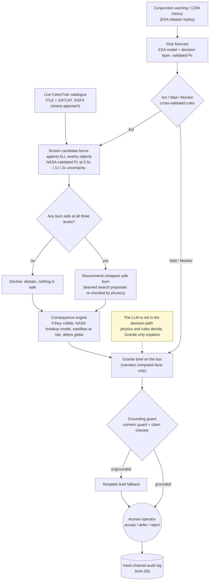
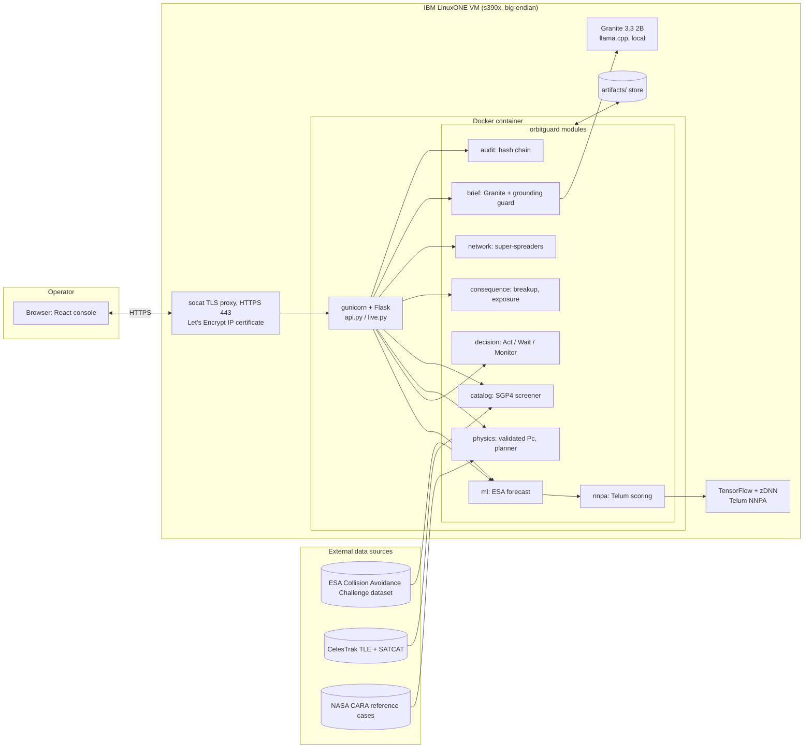

# OrbitGuard solution overview

Supporting document for the IBM Z Datathon 2026 submission (event code `SSF2026`). It collects the solution flowchart,
the system architecture, the pipeline and the deployment in one place. Numbers live in the [README](../README.md)
with their sources; none are repeated here.

## Summary

OrbitGuard is cascade-aware collision-avoidance decision support running on IBM LinuxONE (s390x). For a close
approach, it forecasts risk (ESA Collision Avoidance Challenge data, validated collision-probability physics),
recommends Act, Wait or Monitor, and screens candidate burns against every nearby object in the live CelesTrak
catalogue at three uncertainty levels. If no burn is safe it declines instead of guessing. It then estimates what a
collision would do to other satellites, has a local IBM Granite model write a brief that a grounding guard checks, and
logs every recommendation and operator choice to a hash-chained audit log. The LLM only explains. A human operator
makes every call, and the tool never commands a spacecraft.

## Solution flowchart

Static image for viewers that do not render Mermaid: [diagrams/solution-flowchart.svg](diagrams/solution-flowchart.svg).

Key points: physics and cross-validated rules make the decision; Granite is outside that path and is only
asked to narrate computed facts. If the numeric guard or the claim checker rejects the brief, a template brief is
shown instead.

## System architecture

Static image: [diagrams/system-architecture.svg](diagrams/system-architecture.svg). The earlier module-level diagram
is in the [README Architecture section](../README.md#architecture), and the catalogue and consequence path is in
[architecture-catalog.md](architecture-catalog.md) ([SVG](architecture-catalog.svg)).

## Data flow and pipeline

`bash scripts/run-linuxone-pipeline.sh` regenerates every measured number on the VM. Required steps stop at the first failure,
and each step's output and timing is written to `artifacts/pipeline/`.

| Stage | Steps (`orbitguard <command>`) | Produces |
| --- | --- | --- |
| Historical ESA forecasting | `train`, `evaluate`, `audit-accuracy`, `train-triage`, `evaluate-triage`, `train-guard`, `evaluate-guard` | Frozen model, sealed-label evaluation, accuracy audit |
| Decision layer | `decision-fit`, `decision-eval`, `workload-eval` | Act / Wait / Monitor rules, calibrated P(high), interval, workload evidence |
| Physics and synthetic suite | `validate-physics`, `benchmark-planner`, `optimise-burns`, `benchmark-runtime` | Pc validation against NASA CARA cases, 50-scenario stress test, learned burn search, latency |
| Live catalogue (skipped with `SKIP_CATALOGUE=1`) | `screen-live`, `validate-breakup`, `network`, `consequence` | ISS screen, breakup-model validation, close-approach network, Pc-versus-harm survey |

## Deployment

- IBM LinuxONE Community Cloud VM (s390x, big-endian). The code uses explicit byte order and models are retrained on the VM.
- A multi-stage Dockerfile builds the React console and runs gunicorn on the official s390x image, listening on loopback port 8080.
- Public access is HTTPS on port 443 through a socat TLS proxy with a Let's Encrypt IP certificate. A systemd unit
  (`scripts/linuxone-public.sh`) re-exposes it after reboot, and a timer renews the certificate.
- Granite runs locally in llama.cpp on a big-endian GGUF, so no external AI API is called. Only public TLE and SATCAT downloads come in.
- Step-by-step: [vm_runbook.md](vm_runbook.md) and [porting.md](porting.md).

## Further technical documentation

| Document | What it holds |
| --- | --- |
| [README](../README.md) | Problem, results with their sources, limitations, credits |
| [JUDGING_GUIDE.md](JUDGING_GUIDE.md) | Each judging criterion with the command or file that proves it |
| [RESULTS.md](RESULTS.md) | LinuxONE deployment report |
| [ACCURACY_REVIEW.md](ACCURACY_REVIEW.md) | ESA scoring reproduction and forecast fixes |
| [RECALL_IMPROVEMENT.md](RECALL_IMPROVEMENT.md) | Work on high-risk recall |
| [DATA_BOUNDARIES.md](DATA_BOUNDARIES.md) | Which code may read labels, enforced by tests |
| [EVENT_REPLAY.md](EVENT_REPLAY.md) | How historical events are replayed |
| [breakup-validation.md](breakup-validation.md) | Breakup model against real fragmentation events |
| [architecture-catalog.md](architecture-catalog.md) | Catalogue and consequence architecture ([SVG](architecture-catalog.svg)) |
| [phases/README.md](phases/README.md) | Per-phase build notes |
| [evidence/README.md](evidence/README.md) | Review artefacts |
| [labs/README.md](labs/README.md) | Executed prerequisite-lab notebooks |
| [vm_runbook.md](vm_runbook.md) | VM runbook |
