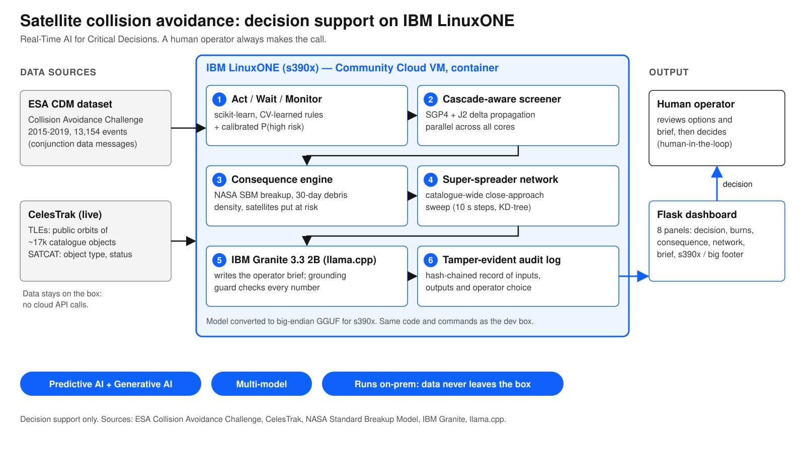

# Architecture

Data flows left to right. Everything inside the blue box runs on the IBM LinuxONE (s390x) Community Cloud VM, in a container. Nothing leaves the box.

1. **ESA CDM dataset.** 13,154 training events from the ESA Collision Avoidance Challenge (2015-2019). It trains and tests the decision layer.
2. **CelesTrak.** Live TLEs (public orbit descriptions) and SATCAT (object type and status) feed the screener, consequence engine and network.
3. **Act / Wait / Monitor.** Starts from the naive "latest CDM risk" baseline. Rules chosen by cross-validation and a calibrated P(high risk) give ACT, WAIT or MONITOR with reasons.
4. **Cascade-aware screener.** Tests 145 candidate burns. SGP4 gives the path; a J2 model run with and without the burn supplies only the difference. Work is split across all cores.
5. **Consequence engine.** NASA Standard Breakup Model makes the fragments, J2 spreads them into a 30-day density map, and every active satellite is flown through it. Expected harm = Pc x expected encounters.
6. **Super-spreader network.** A catalogue-wide close-approach sweep (about 17k objects, 24 hours, 10 km links) finds objects that could seed a chain reaction.
7. **IBM Granite 3.3 2B.** Runs locally through llama.cpp (big-endian GGUF on s390x) and writes the operator brief. A grounding guard checks every number against the facts, else a template brief is used.
8. **Audit log.** Tamper-evident record of inputs, outputs and the operator's choice.
9. **Flask dashboard.** One page for the event, decision, burns, consequence, network and brief. The footer shows CPU architecture and byte order.
10. **Human operator.** Makes the final decision. This is decision support, not autonomy.
